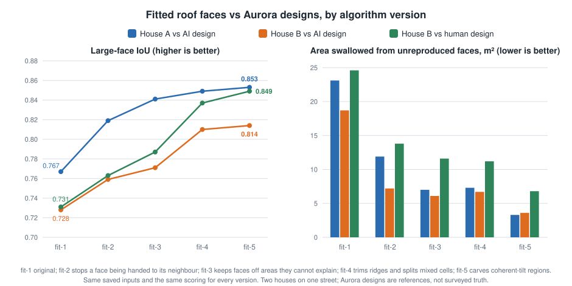
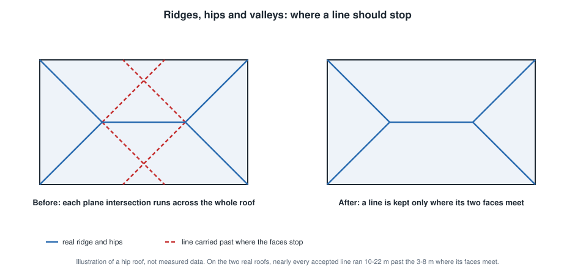
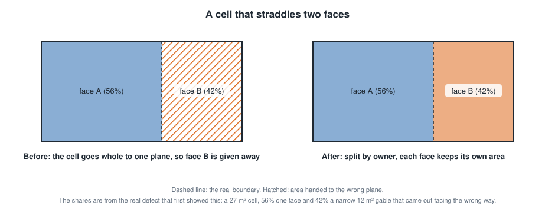
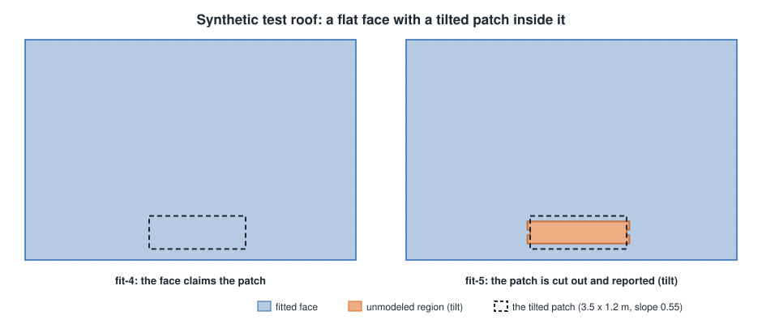

# Roof face accuracy: results against Aurora designs

How well the fitted roof faces (`backend/roof_fitting.py`, versions `fit-1` to `fit-6`) match roof designs made in Aurora Solar, on three houses. Scores come from the benchmark in [`experiments/roof-vision/aurora-benchmark`](../experiments/roof-vision/aurora-benchmark/README.md). Everything here is experimental and no result is design-ready.

## Summary

- On houses A and B, which are on one street, large-face IoU against the Aurora designs rose on all three cases, from 0.73-0.77 to 0.81-0.87, and area swallowed from faces we do not reproduce fell by 72-86%.
- On house C, a simpler roof in a different neighbourhood, large-face IoU fell from 0.820 (`fit-2`) to 0.792 (`fit-5`) and the swallowed area did not change (9.3 m2). `fit-6` recovers 0.003 of that (0.795). The remaining 0.025 is not recoverable from the height data without contradicting it; see the house C section. The gains are not shown to carry over to other roofs.
- `fit-6` joins hips and ridges where their lines meet. It was found while diagnosing house C: it raised house A by 0.016 and house C by 0.003 and left both house B cases unchanged. House C is therefore no longer a held-out case.
- Ridge trimming (`fit-4`) now helps on three of four cases (house A +0.006, house B +0.010 and +0.030) and costs house C 0.012.
- The outer outline was already close on all three houses (IoU 0.956-0.975) and did not change.
- On houses A and B the fitted stage used to be clearly worse than the raw stage it starts from (house B: 0.771 against 0.807). It is now level with or above it, with straight edges. On house C it is 0.795 against 0.790, but `fit-1` and `fit-2` were about 0.03 above the raw stage, so there the fits lost an advantage they had.
- Not solved: small hips and facets as faces, obstructions (vents are not visible in a 10 cm height model), a reference split the heights cannot see (house C), and the cost of reporting more of the roof as unmodeled (coverage down 0.02-0.03).

## What was measured

A saved reconstruction for a house is scored against the Aurora design for the same house (exported as DXF). The DXF has no georeference, so its outline is registered to ours by rotation and shift; that fit absorbs any constant offset, so overlap scores are slightly optimistic. Only the largest connected structure in the DXF is scored (designs include neighbouring roofs for shading).

| Metric | Meaning |
|---|---|
| Large-face IoU | Area-weighted best intersection-over-union of our faces against the reference faces of 3 m2 or more |
| All-face IoU | The same over every reference face |
| Face recall | Share of reference roof area reproduced by a face at IoU of 0.5 or more |
| Absorbed area | Area of reference faces we did not reproduce that our faces nevertheless cover, i.e. claimed by a neighbour |
| Coverage | Share of the roof outline covered by fitted faces |

Four cases: house A against its AI-made Aurora design, house B against its AI-made design, house B against a human-made design (the better reference: its lines sit on the visible roof edges in a 2 cm image, while the AI design's hips were about 0.5 m off), and house C against its AI-made design. Houses A and B were used to develop and tune `fit-2` to `fit-5`. House C was first scored with no change to the code; `fit-6` was then found by diagnosing it. House C has no human-made design.

## Results by version

Fitted stage, large-face IoU (higher is better):

| Case | fit-1 | fit-2 | fit-3 | fit-4 | fit-5 | fit-6 | raw stage |
|---|---|---|---|---|---|---|---|
| House A vs AI design | 0.767 | 0.819 | 0.841 | 0.849 | 0.853 | **0.869** | 0.850 |
| House B vs AI design | 0.728 | 0.759 | 0.771 | 0.810 | 0.814 | **0.814** | 0.807 |
| House B vs human design | 0.731 | 0.763 | 0.787 | 0.837 | 0.849 | **0.849** | 0.839 |
| House C vs AI design | 0.820 | 0.820 | 0.811 | 0.792 | 0.792 | 0.795 | 0.790 |

Area absorbed from faces we do not reproduce, m2 (lower is better):

| Case | fit-1 | fit-2 | fit-3 | fit-4 | fit-5 | fit-6 |
|---|---|---|---|---|---|---|
| House A vs AI design | 23.1 | 11.9 | 7.0 | 7.3 | 3.3 | **3.3** |
| House B vs AI design | 18.7 | 7.2 | 6.1 | 6.7 | 3.6 | **3.6** |
| House B vs human design | 24.6 | 13.8 | 11.6 | 11.2 | 6.8 | **6.8** |
| House C vs AI design | 9.3 | 9.3 | 9.3 | 9.3 | 9.3 | 9.3 |

Final state (`fit-6`):

| | House A vs AI | House B vs AI | House B vs human | House C vs AI |
|---|---|---|---|---|
| Reference faces (3 m2 or more) / ours | 16 (11) / 9 | 11 (8) / 7 | 14 (9) / 7 | 8 (8) / 7 |
| All-face IoU | 0.847 | 0.810 | 0.830 | 0.795 |
| Face recall | 0.943 | 0.972 | 0.934 | 0.969 |
| Outline IoU / edge gap p90 / max | 0.972 / 0.24 / 0.55 m | 0.962 / 0.30 / 0.61 m | 0.956 / 0.36 / 0.85 m | 0.975 / 0.29 / 0.64 m |
| Coverage / reported unmodeled | 0.919 / 6.2 m2 | 0.928 / 6.1 m2 | 0.928 / 6.1 m2 | 0.950 / 0.0 m2 |
| Obstructions found, false positives | 0 of 7, 1 | 1 of 11, 0 | 3 of 12, 0 (see note) | 2 of 17, 1 |

Note: the human design draws one chimney as three shapes and our single candidate matches all three, so "3 of 12" is about one of ten physical objects. Fourteen of house C's 17 reference obstructions are vents. The full per-version table is in [`results.json`](images/roof-accuracy/results.json). Height RMSE is in that file but is measured over different areas before and after `fit-3`, so it is not comparable across that change.

## House C: why it stays below fit-2

House C has a simple roof: the Aurora design has 8 faces, all of 3 m2 or more, and we produce 7, with two reference faces merged into one of ours. Large-face IoU fell by 0.028 from `fit-2` to `fit-5`: 0.009 at `fit-3` and 0.019 at `fit-4`. `fit-6` gives back 0.003. To find what is left, fit-2's ownership was restored region by region into the `fit-6` result and the score re-measured:

| Piece of the 0.025 gap | Worth | What the data say |
|---|---|---|
| A 2.5 m2 piece of the south face beside the chimney hole, where Aurora has the north face | 0.015 | The height model follows the south plane there (0.08 m residual) and not the north plane (0.51 m). `fit-2` gave it to the north face with no height check. `fit-3`, and any version with trimming off, cut it out as unmodeled. With trimming on, its cell carries only the south label and the south plane explains it, so the south face keeps it. |
| Thin eave bands, 0.2-0.3 m wide, about 10 m2 along the outline | 0.007 | Height residual is high at the roof edge, so these areas are left out of the faces rather than claimed. Merging thin bands back moved house C by +0.001 and house A by -0.006. Assigning them by plane fit changed nothing on house C. |
| Small pieces along hips and valleys | 0.003 | A few tenths of a m2 each, in both directions. |

Getting the first piece back would mean handing it to a plane that is 0.5 m off in height, or cutting it out as unmodeled. The second was tried as a prototype: a cell that a face holds wholly beyond an accepted ridge, on the far side from that face and inside the ridge's extent, goes to the face on that side, and the height check then cuts it out as unmodeled. It lifted house C from 0.795 to 0.803 (the same result for tolerances of 0.2-0.35 m and any size cap from 3 m2 up), moved one 0.5 m2 cell on house A (-0.001) and nothing on either house B case. A rule that only fires on the one roof it was built for is fitted to that roof, so it was dropped and is not in the code.

Separately, and in every version, two reference faces are merged into one of ours (9.3 m2 absorbed, the figure that never changes). They are nearly coplanar: one is a plane at 0.9 degrees slope, the other is not a clean plane, they share only 2 m of boundary, and the planes differ by under 7 cm along it. Heights cannot separate them; only the photo could. Splitting them correctly would be worth roughly 0.04 on this house (an estimate, not a measurement).

Ridge trimming on and off, everything else as in `fit-6`, large-face IoU:

| Case | Trimming on (`fit-6`) | Trimming off |
|---|---|---|
| House A vs AI design | 0.869 | 0.863 |
| House B vs AI design | 0.814 | 0.804 |
| House B vs human design | 0.849 | 0.819 |
| House C vs AI design | 0.795 | 0.807 |

On house C trimming costs 0.012, about the size of the first piece above: without trimming that piece is cut out as unmodeled instead of kept by the south face. Trimming is a net gain on the other three cases.

## What each version changed

- **fit-2: a plane lost to its neighbour.** A 12 m2 face facing west was given to the large east-facing plane, a 180 degree azimuth error. After a ridge candidate was rejected, neighbouring ridges erased half of the shared boundary, leaving a cell that mixed both planes, and a cell goes whole to one plane. Fix: keep the label boundary of rejected pairs, and report any plane that keeps under half its source area.
- **fit-3: faces no longer claim what their plane cannot explain.** Connected areas of at least 0.5 m2 more than 0.35 m off a face's plane are cut out and reported as unmodeled regions instead of being absorbed.
- **fit-4: ridges stop where their faces stop.** Nearly every accepted plane-intersection line ran 10-22 m past the 3-8 m where its two faces meet. Lines are trimmed to their supported span, and cells that straddle faces are split by owner (trimming alone collapsed a roof to four faces, so the two changes go together). With `fit-6` it helps on every case but house C.
- **fit-5: coherent-tilt regions.** A hip beside larger faces fits their planes to about 10 cm, so no height test sees it, but its slope differs. Compact patches whose local slope disagrees coherently with their owner are cut out and reported as unmodeled regions of kind `tilt`. It did not change any scored metric on house C.
- **fit-6: ridges meet where they cross.** A ridge's supported span stops a little short of the point where it meets the next ridge, so hips dangled. Each end now also runs on, within the existing 1.5 m reach, to the crossing with another accepted ridge when both have evidence near it. On a synthetic hip roof whose raw faces stop 1 m short of the apex it restores the exact 9, 9, 21 and 21 m2 faces that `fit-5` cut to about 6, 6, 21 and 21 m2.

The last figure is the real output of `fit-4` and `fit-5` on the synthetic roof used by `test_fit_leaves_a_hip_sized_tilt_change_unmodeled`. The other two are illustrations, not measured data.

## Straight edges (fit-7)

`fit-7` adds a straightened copy of the faces beside the fit (see [`roof-photo-fitting.md`](roof-photo-fitting.md)). Large-face IoU against the Aurora designs, fitted stage and straightened stage, with the vertices and the share of edge length lying in straight runs of 1 m or more:

| Case | Fitted | Straightened | Vertices (fit -> straightened) | Edge length in straight runs |
|---|---|---|---|---|
| House A vs AI design | 0.869 | **0.873** | 558 -> 138 | 58% -> 85% |
| House B vs AI design | 0.814 | **0.815** | 584 -> 103 | 57% -> 87% |
| House B vs human design | 0.849 | **0.856** | 584 -> 103 | 57% -> 87% |
| House C vs AI design | 0.795 | **0.801** | 720 -> 87 | 61% -> 92% |
| House D vs design | 0.832 | 0.832 | 2,247 -> 186 | 9% -> 79% |

House D is a fourth house. It was held out while `fit-2` to `fit-6` were built, but it was one of the five houses the straightening was developed and its settings swept on, so it is not a held-out test of `fit-7`. It is turned about 41 degrees from the map grid, so it is the case that needs the roof's own frame: snapping to the map's axes (an earlier prototype) cost 0.001-0.009 on the other houses and could not straighten its diagonal edges. Its design has no obstructions drawn, so obstructions are not scored. Our outline there is larger than the design's by about 65 m2, nearly all of it low roofs (a 29 m2 strip and a 12 m2 shallow wing, 0.2-1.5 m above the lowest eave, and part of a 15 m2 flat area) that the design does not contain. Outside those areas the two outlines agree to 99.7%. Whether those are patio covers that belong out of a design is for the owner to say, and the face scores above do not depend on it.

Total roof area is preserved to within 2 m2 on every house, and every face keeps an overlap (IoU) of at least 0.86 with its fitted face. What the straightening does not fix: a 2.5 m2 stray piece beside a chimney that the fit gives to the wrong face, the irregular patio-cover area on house D, chamfered corners longer than 1.6 m, and the small stray teeth where the fit's own faces are wrong.

## Plausibility report (fit-8)

`fit-8` adds a report of how the straightened faces compare with how pitched roofs are built (see [`roof-photo-fitting.md`](roof-photo-fitting.md)). It changes no face and does not change any score above. Per house, for the straightened faces:

| House | Framing pitch (spread) | Shared edges | Meeting at one height | Real steps | Low-slope faces | Review |
|---|---|---|---|---|---|---|
| A | 22.1 deg = 5:12 (10.2) | 47 m | 75% | 8% | 1 | yes: one 13 m2 face 9 degrees under the framing pitch |
| B | 22.3 deg = 5:12 (3.7) | 36 m | 77% | 0% | 1 | no |
| C | 18.9 deg = 4:12 (1.2) | 64 m | 94% | 0% | 1 | no |
| D | 19.0 deg = 4:12 (2.8) | 35 m | 64% | 23% | 2 | no |
| E | 23.1 deg = 5:12 (6.8) | 40 m | 55% | 0% | 1 | yes: one 21 m2 face 5 degrees over the framing pitch |

Straightening can cost physical consistency, which the benchmark (silhouettes only) does not see. Share of shared-edge length where the two planes meet within 0.15 m on average, fit to straightened: house A 85% to 75%, B 80% to 77%, C 87% to 94%, D 81% to 64%, E 95% to 55%. On house E most of the drop is one edge: the 17.7 m main ridge moves from a 0.05 m gap to 0.16 m, about 0.2 m off where its planes meet, which just crosses the threshold; the other pairs stay within about 0.1 m. Keeping edges that are already consistent on their plane lines while straightening is open: a plane-intersection snap added after the fact did not do it (see the findings below).

House E is a fifth house that has no Aurora design yet, so it is not scored elsewhere in this document. The main faces of every house sit within 0.6 degrees of one standard pitch, which is the regularity a construction-aware step can lean on. The two reviews may be real (a lower-pitched valley face, a steeper gable) or fit errors; the report cannot tell which.

## Findings that did not become code

- **A5/A7 (a ring Aurora draws around a flat roof) is not a height defect.** The ring is coplanar with the roof in the heights (median offset -0.02 m, 3 degrees). Only the photo separates them. House C has the same kind of split.
- **Small hips cannot be recovered as faces from this height model.** A plane fitted to a hip's core explains almost nothing beyond it: the 10 cm DSM is too smooth for a 2 m hip to form a clean plane. They are reported as unmodeled instead of being given an invented plane.
- **Vents are not visible in the heights** (rise of 0.03-0.17 m for a 7 inch vent), and are at best faint in a 10 cm photo. On house C we found 2 of 17 reference obstructions, 14 of which are vents.
- **Raising the image resolution through the current tool changes nothing.** The photo path shrinks images to 0.1 m and nudges lines by about 6 cm. A 2 cm image showed that outer edges are already within about 6 cm and that interior lines need a different detector.
- **A side-of-ridge rule is house-C-only.** Moving cells that a face holds on the far side of an accepted ridge to the face on that side gives house C +0.008, house A -0.001 and no change on house B, so it was dropped (see the house C section).
- **Snapping edges to plane intersections did not help.** An edge between two faces was moved onto the line where their planes meet when it lay within 0.6 m of it. Against the straightened faces without it, large-face IoU changed by -0.001 on house A, +0.005 and -0.008 on house B (AI and human design), -0.002 on house C and -0.001 on house D, with every other setting tried between -0.008 and +0.005, and the average vertical gap along shared edges fell by only 0.01-0.02 m. The ridges and hips that matter already sit on plane intersections (gaps of 0.05-0.06 m); the large gaps are between near-parallel faces at different heights, up to 1.2 m, which are real steps where a plane intersection means nothing. Letting the moved edges take any direction lost a face on house A. It was removed.
- **Ridge reach and end slack are not the lever.** Changing the reach from 0.75 to 3 m changed nothing; 6 m and 12 m helped house A and hurt house B. Extending every unconnected end by 0.5-2 m gave the same result as `fit-6` (so the gain is from ends that fail to meet, not from length), but it is arbitrary where `fit-6` is bounded by evidence.

## Limits

- Three houses and four references, all AI-made except one. Houses A and B are on one street, and thresholds (reach, share, tilt gap, width) were swept on those two only. House C was the one house outside that set and got worse, and since `fit-6` was found while diagnosing it, a new house is needed to test whether the changes generalise. One more roof does not establish a rate in either direction.
- Aurora designs are references, not surveyed truth. Registration is a fit.
- Sources are Google Solar data with a 10 cm height model. Higher-resolution imagery or lidar might change which of these limits hold.

## Data handling

The Aurora designs, saved reconstructions, imagery and per-house reports used for these numbers are private. They live in the git-ignored `experiments/roof-vision/aurora-benchmark/private/` folder, and Google-derived files carry the original acquisition expiry. Nothing here is a property-specific output: houses are anonymised, the figures use only aggregate numbers, illustrations and synthetic test data, and no imagery is included. To reproduce on your own data, see the benchmark README.
